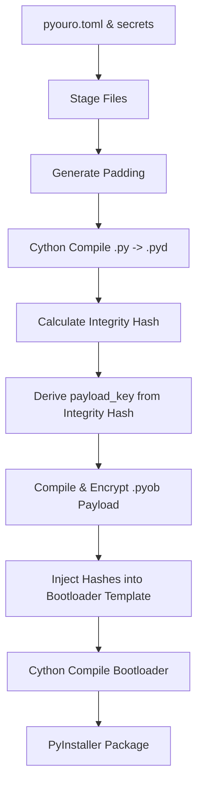

# PyOuro Full Security Review

## Executive Summary
This document provides a comprehensive security review of the PyOuro framework, a cryptographic trust anchor and DRM solution for Python applications. The review analyzes the architecture, execution flows, cryptographic mechanisms, and integrity protections. 

While PyOuro implements several advanced concepts—such as cryptographic binding of payload to file integrity and AES-GCM encrypted licenses—it suffers from critical architectural flaws in its chain of trust. The most severe vulnerability allows an attacker to completely bypass the integrity checks and decrypt the payload by replacing the PyInstaller bootloader module, which is not cryptographically bound to the payload key. Furthermore, the hardware fingerprinting mechanism is susceptible to unprivileged spoofing via environment variable manipulation.

## Scope
The analysis covers the following components:
- CLI and Builder (`pyouro.cli`, `builder/build_cmd.py`, `builder/compiler.py`)
- Cryptographic Vault and Licensing (`crypto/vault.py`, `core/license_cmd.py`)
- Runtime Bootloader (`builder/bootloader_template.py`, `api.py`)
- Integrity Verification (`crypto/vault.py`, `core/hardware.py`, `core/keyring_mgr.py`)

## Architecture and Threat Model
PyOuro aims to protect against reverse engineering, memory dumping, and unauthorized execution.
- **Attacker Profile**: Assumed to have full local access to the machine, the distributed executable, and potentially administrative privileges.
- **Assets**: Source code (payload), developer secrets, licensing mechanisms.
- **Trust Anchor**: Hardware identity and RSA-PSS signatures.

## Security Flaws & Bypass Vectors

### 1. Bootloader Exclusion from Cryptographic Binding (CRITICAL)
The core security mechanism derives the `payload_key` from an `integrity_hash` of the compiled `.pyd` files. However, `bootloader_template.py` is compiled *after* the `integrity_hash` is calculated (to inject the hash list). Consequently, `bootloader.pyd` is not included in the `integrity_hash`. An attacker can extract the PyInstaller bundle, decompile or replace `bootloader.pyd` with a custom module that hardcodes the legitimate `integrity_hash`, and dump the decrypted `pyob` payload to disk. 

### 2. Hardware ID Spoofing via Environment Variables (HIGH)
In `core/hardware.py`, the Windows hardware fingerprinting relies on a PowerShell command. It resolves the `powershell.exe` path using `os.environ.get('SystemRoot')`. An unprivileged attacker can set a fake `SystemRoot` environment variable pointing to a custom directory containing a malicious `System32/WindowsPowerShell/v1.0/powershell.exe`. This malicious script can output any hardware serial number the attacker chooses, easily bypassing the node-locked licensing without admin privileges.

### 3. Static Key Derivation for Keyring Fallback (HIGH)
When the OS keyring is unavailable, `keyring_mgr.py` uses a local `.dat` fallback encrypted with AES-GCM. However, the HKDF key used for this encryption is derived from static, hardcoded values (`pyouro_fallback_salt`, `pyouro_static_ikm_for_fallback`) and the (spoofable) hardware ID. An attacker can decrypt this fallback file, modify the `time_hwmark` (to defeat anti-rollback), and extract the `seed` to clone the installation.

### 4. DLL Search Order Hijacking & Native Extensions (MEDIUM)
The bootloader verifies the hashes of `.pyd` and `.so` files against `FILE_ORDER_HASHES`, and specifically checks the Python interpreter DLL (`python310.dll`). However, it does not hash or verify other native DLL dependencies (e.g., `libcrypto`, OS-level DLLs). An attacker could place a malicious DLL in the application directory to hook API calls (e.g., `ctypes.memset`, `exec`) in memory.

### 5. TOCTOU in Python DLL Verification (MEDIUM)
The `bootloader` validates the Python DLL by reading it from disk and hashing it. A sophisticated attacker could use filesystem overlays or symlink race conditions (Time-of-Check to Time-of-Use) to present the genuine DLL to the bootloader's read operation, while the OS loader maps a hooked DLL into the process memory.

## Evaluation
- **Portfolio Project / Academic Proof of Concept**: Excellent. It demonstrates advanced understanding of applied cryptography, AST manipulation, Cython compilation, and state protection.
- **Commercial Python Software**: Not recommended for production in its current state without addressing the bootloader chain of trust.
- **Protection Against Expert Reverse Engineering**: Low. The unauthenticated bootloader provides a trivial entry point for extraction tools.

## Conclusion
PyOuro has a strong theoretical foundation, particularly the cryptographic binding of the file integrity hash to the payload decryption key. If the trust chain can be extended to include the bootloader and the PyInstaller entry point, the framework's security posture will improve dramatically.
# PyOuro Architecture and Data Flow

## 1. Initialization Phase (`pyouro init`)
1. **AST Analysis**: Scans entry point and payload for local Python dependencies.
2. **File Order Generation**: Shuffles discovered dependencies into a randomized array and saves it to `.pyouro/file_order.json`. This determines the hashing sequence.
3. **Key Generation**: Generates 2048-bit RSA Keypair (`private.pem`, `public.pem`) and a 32-byte `padding_seed.hex`.

## 2. Licensing Phase (`pyouro license`)
1. Developer provides the client's `hw_id`.
2. Developer's `private.pem` is used to derive a `master_key` via HKDF.
3. The client's `hw_id` is used to derive an AES-GCM key (`aes_key`).
4. The `master_key` is encrypted with the `aes_key`.
5. The payload (type, expiry, encrypted master key) is signed with RSA-PSS and saved as `license.sig`.

## 3. Build Phase (`pyouro build`)

**Data Flow Note**: The payload is encrypted using a key derived from the hashes of the `.pyd` files. This creates a cryptographic binding: tampering with a file changes the hash, yielding the wrong AES key, causing decryption to fail mathematically.

## 4. Runtime Phase (Bootloader)
1. **Anti-Debugging**: Native OS checks (`IsDebuggerPresent`, `ptrace`).
2. **Hardware Fingerprinting**: Re-calculates local `hw_id`.
3. **Integrity Validation**: Hashes `.pyd` files in the exact order defined by `FILE_ORDER_HASHES`. 
4. **Key Derivation**: Computes `integrity_hash` and derives `payload_key`.
5. **Decryption**: Decrypts the `.pyob` payload using AES-GCM.
6. **Time Tampering Check**: Validates and updates the encrypted `time.dat` file and OS keyring.
7. **Execution**: Marshals the decrypted bytecode and executes it in memory via `exec()`.
# Checksum and Integrity Review

## Architecture of Checksums
PyOuro avoids storing a plaintext manifest of file hashes. Instead, it embeds an array of SHA-256 hashes (`FILE_ORDER_HASHES`) directly into the compiled `bootloader.pyd`. 
At runtime, the bootloader reads all `.pyd` files, computes their hashes, maps them to the expected array, and calculates a final aggregate `integrity_hash`.

## Evaluation Table

| File / Component | Included in Checksum? | Expected Hash Location | Validation Time | Authenticity Risk | Bypass Risk |
| :--- | :---: | :--- | :--- | :--- | :--- |
| **Project `.pyd` files** | YES | `FILE_ORDER_HASHES` in Bootloader | Pre-execution | Bound to `integrity_hash` | Low (cryptographically bound) |
| **Padding `.pyd` files** | YES | `FILE_ORDER_HASHES` in Bootloader | Pre-execution | Bound to `integrity_hash` | Low |
| **`python3.dll`** | YES | `EXPECTED_PYTHON_DLL_HASH` in Bootloader | Pre-execution | Hardcoded string check | High (bootloader can be replaced) |
| **`bootloader.pyd`** | **NO** | N/A | N/A | None | **CRITICAL** (Not verified) |
| **PyInstaller Stub (`pyouro_runner.py`)**| **NO** | N/A | N/A | None | High |
| **Other `.dll` (e.g. libcrypto)** | **NO** | N/A | N/A | None | High (DLL Hijacking) |
| **`.pyob` Payload** | YES (Implicit) | AES-GCM Auth Tag | During Decryption | AES-GCM Integrity | Low |
| **License (`license.sig`)** | YES | RSA-PSS Signature | During API Validation | RSA Public Key | Low |

## Distinctions

1. **Integrity on disk vs memory**: PyOuro checks the files on disk. Once loaded into RAM, the process memory is susceptible to hooking. The native anti-debug checks attempt to mitigate this, but an advanced kernel-level driver can easily bypass them.
2. **Authenticity of the manifest**: The "manifest" is the `FILE_ORDER_HASHES` list embedded in the bootloader. Because the bootloader itself is unverified, the manifest lacks authenticity.
3. **Protection of plaintext**: The plaintext is kept as a marshalled code object in Python memory. A memory dumper can extract it. The `_crash` function attempts RAM wiping via `ctypes.memset`, but this only works *after* a crash is initiated, not against passive memory dumping while the app is running.
# Claim Validation vs Actual Implementation

| Documented Claim | Implemented? | Code Evidence | Limitations | Assessment |
| :--- | :---: | :--- | :--- | :--- |
| **Hardware Cryptographic Binding** | Yes | `license_cmd.py` (HKDF deriving AES key from HW ID) | Floating licenses bypass this completely if enabled. HW-ID spoofable via env vars on Windows. | Partially Verified |
| **In-memory Decryption** | Yes | `bootloader_template.py:172` (`exec(code_obj)`) | Code object remains in Python heap. | Verified |
| **RAM Wiping** | Yes | `bootloader_template.py:28` (`ctypes.memset(id(val) + offset, 0, len(val))`) | Only triggers on explicitly caught security violations, not on sudden termination or passive dumping. | Partially Verified |
| **OS-level anti-debugging** | Yes | `bootloader_template.py:59` (`IsDebuggerPresent`, `ptrace`) | Basic user-mode checks. Easily bypassed by ScyllaHide or kernel debuggers. | Verified |
| **Signed Python interpreter** | No | `bootloader_template.py:116` | It only checks the SHA-256 hash against a hardcoded string. It does not verify Authenticode signatures. | Contradicted by code |
| **SSD Wear-leveling Mitigation** | Yes | `compiler.py:27` (Avoids copying `.py` files to staging) | `.c` Cython artifacts are securely wiped, but OS temp files might still leak. | Verified |
| **Encrypted Timestamp Database** | Yes | `bootloader_template.py:223` (AESGCM encrypted `time.dat`) | Susceptible to full-state rollback if both the file and keyring are deleted. | Partially Verified |
| **I/O Atomicity / DoS Protection** | Yes | `bootloader_template.py:177` (`msvcrt.locking`, `fcntl.flock`) | | Verified |
| **Opaque Failure States** | Yes | `diagnostics.py:44` (`Fatal Error: E01`) | | Verified |
| **Container Floating Licenses** | Yes | `hardware.py:11` (`PYOURO_CONTAINER_KEY`) | Makes the DRM trivial to bypass if the container key is extracted. | Verified |
[
  {
    "id": "VULN-001",
    "severity": "Critical",
    "file": "pyouro/builder/build_cmd.py",
    "line": 159,
    "behavior": "bootloader.pyd is compiled and bundled after the integrity_hash is calculated, meaning it is not cryptographically bound to the payload key.",
    "impact": "Complete compromise of payload encryption. Attacker can replace bootloader.pyd to extract the plaintext payload or bypass anti-debugging.",
    "exploit_scenario": "Attacker unpacks PyInstaller executable, replaces bootloader.pyd with a patched version that hardcodes the valid integrity_hash, and writes the decrypted payload to disk.",
    "preconditions": "Access to the compiled executable.",
    "explanation": "Because the bootloader injects FILE_ORDER_HASHES, it cannot hash itself. By excluding it from the derivation of pysb_key, the root of trust is left unauthenticated.",
    "remediation": "Use a two-stage build or bootstrap. Hash the compiled bootloader, inject its hash into a lightweight unencrypted PyInstaller runner, and have the runner pass it to the bootloader, or compute the hash of the bootloader dynamically and include it in the integrity_hash before payload encryption."
  },
  {
    "id": "VULN-002",
    "severity": "High",
    "file": "pyouro/core/hardware.py",
    "line": 19,
    "behavior": "Windows hardware fingerprinting uses os.environ.get('SystemRoot') to locate powershell.exe.",
    "impact": "Unprivileged local attackers can spoof the hardware ID.",
    "exploit_scenario": "Attacker sets SystemRoot to 'C:\\FakeRoot', places a malicious powershell.exe in the expected subpath, and makes it return the HW ID of a licensed machine.",
    "preconditions": "Ability to set environment variables before execution.",
    "explanation": "Environment variables are entirely under user control and cannot be trusted for security-critical paths.",
    "remediation": "Use hardcoded absolute paths (e.g., 'C:\\Windows\\System32\\...') or native Windows API calls (via ctypes/wmi) instead of shelling out to PowerShell."
  },
  {
    "id": "VULN-003",
    "severity": "High",
    "file": "pyouro/core/keyring_mgr.py",
    "line": 35,
    "behavior": "Fallback HKDF key derivation uses hardcoded static salts and info.",
    "impact": "Attacker can decrypt the local fallback keyring to extract the seed or modify the time_hwmark for unlimited demo usage.",
    "exploit_scenario": "Attacker writes a Python script importing AESGCM, derives the key using the known HW ID and static salt, decrypts the fallback .dat, lowers the timestamp, re-encrypts, and replaces the file.",
    "preconditions": "Application runs in an environment where the OS keyring is unavailable (triggering fallback).",
    "explanation": "Symmetric encryption keys derived from static hardcoded values in open source code provide no confidentiality against local attackers.",
    "remediation": "If an OS keyring is unavailable, require the user to provide a secure environment variable for the vault seed, rather than storing it locally with static keys."
  },
  {
    "id": "VULN-004",
    "severity": "Medium",
    "file": "pyouro/builder/bootloader_template.py",
    "line": 126,
    "behavior": "The integrity check only iterates over files with .pyd or .so suffixes.",
    "impact": "Attacker can introduce malicious .py, .dll, or .dylib files into the bundle directory.",
    "exploit_scenario": "Attacker injects a malicious cryptography.py or loads a proxy DLL that hijacks the execution flow before or during the bootloader execution.",
    "preconditions": "Ability to modify the extracted PyInstaller bundle or execution directory.",
    "explanation": "Whitelisting by suffix leaves blind spots. PyInstaller loads many native DLL dependencies (like libcrypto) which are not verified.",
    "remediation": "Generate a cryptographic manifest of ALL files in the bundle directory at build time, and verify the entire directory tree."
  },
  {
    "id": "VULN-005",
    "severity": "Medium",
    "file": "pyouro/builder/bootloader_template.py",
    "line": 218,
    "behavior": "Anti-rollback time protection relies on comparing current_time with a stored state. Deleting the file and keyring state resets the clock.",
    "impact": "Attacker can extend demo licenses indefinitely.",
    "exploit_scenario": "Attacker takes a snapshot of the VM, or simply deletes APP_time.dat and wipes the OS keyring entry.",
    "preconditions": "Local filesystem access.",
    "explanation": "There is no server-side validation. If the local state is completely wiped, the application assumes it's a fresh install on that hardware.",
    "remediation": "Bind the time state to the license file itself (e.g., license contains issued_at, reject system time before issued_at), but local-only DRM cannot fundamentally prevent full-state rollbacks."
  }
]
# Remediation Roadmap

This document outlines the recommended steps to address the vulnerabilities identified in the PyOuro security review.

## 1. Quick Wins (Immediate Action)
- **Fix Hardcoded Fallback Keys (VULN-003)**: Remove the static HKDF derivation salts in `keyring_mgr.py`. If the OS keyring is unavailable, either refuse to run or require an injected environment variable (e.g., `PYOURO_VAULT_SEED`) from a secure CI/CD pipeline or admin context. Do not store the seed on disk encrypted with a predictable key.
- **SystemRoot Hijacking (VULN-002)**: In `hardware.py`, remove `os.environ.get('SystemRoot')`. Hardcode the fallback paths to `C:\Windows\System32\WindowsPowerShell\v1.0\powershell.exe` or better, invoke WMI directly via Python's `comtypes` or `wmi` libraries.
- **Enforce Absolute Imports**: In `dependency_analyzer.py`, ensure that padding generation cannot cause naming collisions with standard library modules.

## 2. High-Priority Fixes (Next Release)
- **Cryptographic Bootloader Binding (VULN-001)**: 
  Currently, `bootloader.pyd` is outside the `integrity_hash`. Change the build pipeline:
  1. Calculate `integrity_hash` of payload and dependencies.
  2. Compile `bootloader.pyd` with the `FILE_ORDER_HASHES`.
  3. Hash `bootloader.pyd` itself.
  4. Create a minimal PyInstaller `runner.py` that includes the `bootloader.pyd` hash.
  5. The `runner.py` verifies `bootloader.pyd` before importing it.
  Alternatively, inject a digital signature (using the developer's private key) into the bootloader and have the PyInstaller runner verify it using the embedded public key before execution.
- **Time Tampering Resilience (VULN-005)**:
  Include the `issued_at` timestamp inside the signed license payload. In `bootloader_template.py`, reject execution if the system time is earlier than `issued_at`. This prevents trivial time rollbacks even if the local `_time.dat` and keyring are wiped.

## 3. Architectural Improvements
- **Comprehensive Manifest Verification (VULN-004)**:
  Instead of only hashing `.pyd` and `.so` files, generate a cryptographically signed manifest of *every* file included in the PyInstaller `--onedir` bundle (including `.dll`, `.pyd`, `.so`, and `.py` files). Verify this full manifest before deriving the payload key.
- **Dynamic Key Generation for Padding**: 
  Instead of predictable padding algorithms, generate completely randomized AST trees for padding files at build time to thwart statistical analysis and pattern matching.

## 4. Long-Term Hardening
- **Native Hardware Fingerprinting**: As noted in the project roadmap, move away from high-level WMI/PowerShell commands. Implement a C/C++ native extension that queries kernel APIs directly (`DeviceIoControl` on Windows, `IOKit` on macOS) to prevent trivial user-mode spoofing.
- **Kernel-Level Anti-Debugging**: Integrate a driver-based approach or more advanced PEB (Process Environment Block) traversal on Windows to detect ScyllaHide and kernel debuggers.
- **Custom Python Interpreter**: Instead of bundling standard Python DLLs, compile a custom CPython interpreter with the PyOuro bootloader embedded directly in `Python/pythonrun.c`. This completely eliminates the DLL Hijacking and Python hooking vectors, making the interpreter and the DRM natively bound.
